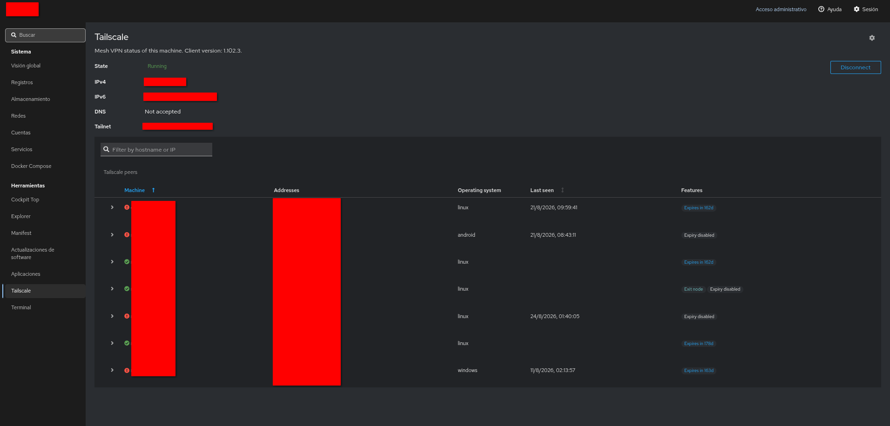
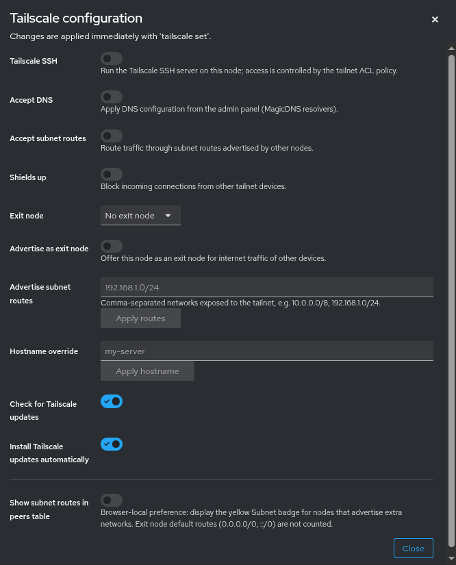

# Cockpit Tailscale

A [Cockpit](https://cockpit-project.org) application to manage
[Tailscale](https://tailscale.com) on the local machine.



## Features

* Connect / disconnect from the tailnet, including the login flow
* Full client configuration (`tailscale set`) in one dialog:



  Tailscale SSH, Accept DNS, Accept subnet routes, Shields up,
  exit node selection and advertisement, hostname override and
  automatic updates.
* Peers table with search, sorting and expandable details, plus
  capability badges per peer: SSH, exit node offers, advertised
  subnets and key expiry (days remaining, or disabled).

Requires **Tailscale >= 1.34** (for `tailscale set`) and Cockpit >= 137.

## Development

Requirements: Node.js >= 20 and npm >= 9.

```bash
$ npm install
```

| Command | Description |
|---|---|
| `make dev` / `make watch` | development build / with watch mode |
| `make build` | production build into `dist/` |
| `make check` | lint + typecheck + unit tests |
| `make devel-install` | symlink `dist/` into `~/.local/share/cockpit/tailscale` |

After linking, reload Cockpit (log out and back in the first time).
`make devel-uninstall` removes the link again.

### Packaging

```bash
$ make dist    # release source tarball
$ make rpm     # binary RPM (requires rpmbuild, e.g. on Fedora/RHEL)
```

## License

LGPL-2.1-or-later, see [LICENSE](./LICENSE).

Based on the repository
[gbraad/cockpit-tailscale](https://github.com/gbraad/cockpit-tailscale)
by [Gerard Braad (@gbraad)](https://github.com/gbraad).
